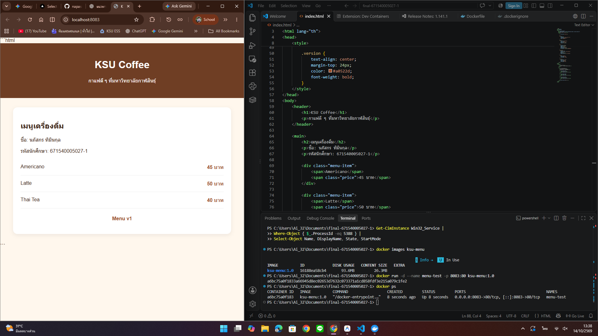
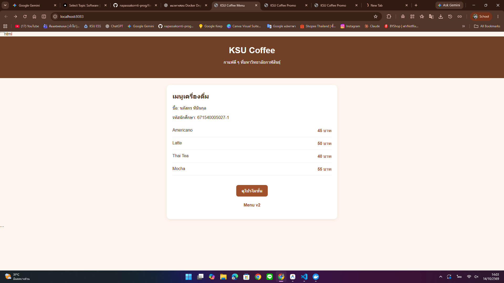
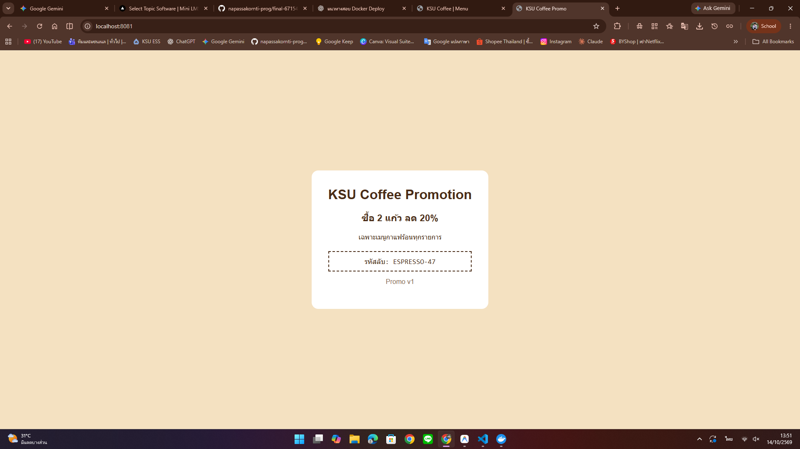

# Docker Final Exam Answers

## Part A: Inspect the promo image

1. **Port:** `3000` is the application port used by the Compose configuration. The image also exposes port `80`.
2. **CMD:** `nginx -g 'daemon off;'`
3. **Base image:** The image history shows an Alpine Linux base filesystem. Verify the exact base image name and tag from available image metadata before submitting.

## Part B: Promo secret

Secret displayed on the promo page: `ESPRESSO-47`

## Part C: Questions

1. The promo page is served from a prebuilt image, so editing my local `index.html` does not change it. The menu page is built from my own source file, so I can edit it and rebuild the image.

2. If an image tag is omitted, Docker uses the `latest` tag by default.

3. The left side of a port mapping is the host port; the right side is the container port. The promo service uses `8081:3000` because the application port is `3000`, not `80`.

4. Running `docker compose up -d` alone may not rebuild the image after source changes. Use `docker compose up -d --build` to rebuild and recreate services when needed.

5. The menu URL is `http://localhost:8080` and the promo URL is `http://localhost:8081`. The name `promo` is Compose service DNS for containers on the Compose network; a browser on the host does not normally resolve that service name.

